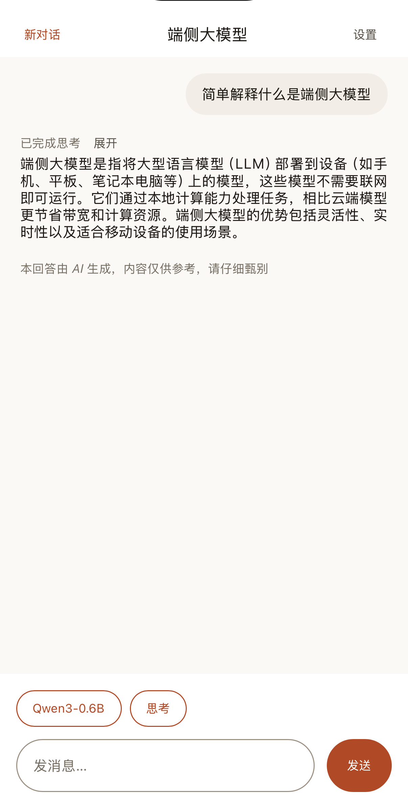
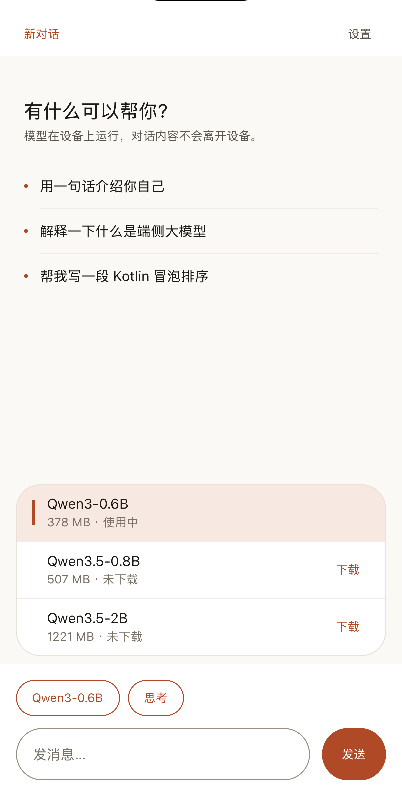
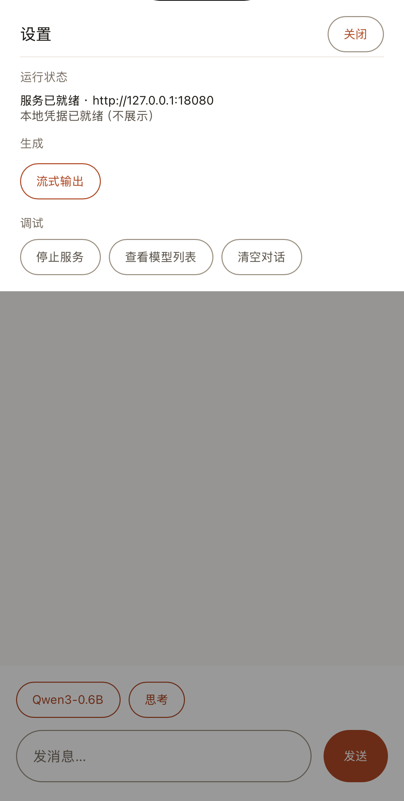

# KuiklyLLMProvider

面向 Kuikly 的端侧模型服务组件。它在设备上启动一个兼容 OpenAI API 的本地 HTTP 服务，
提供 Qwen GGUF 模型资产与下载管理，支持 Android、iOS 和 HarmonyOS。

业务页面只需启动和停止服务；对话请求通过标准 HTTP 发起，可改用任意兼容
OpenAI API 的服务端点。本组件不提供对话界面或对话 SDK。

## 功能特性

- 本地 HTTP 服务监听 `127.0.0.1`，端点需携带 `Authorization: Bearer <apiKey>`
- 服务启停与状态查询：`start` / `stop` / `status`
- 模型管理：`models` 返回状态快照，支持下载、暂停、续传、取消、切换与删除
- 三个 Qwen GGUF 模型，下载支持断点续传与 SHA-256 校验
- 兼容端点：`/health`、`/v1/models`、`/v1/chat/completions`、`/v1/completions`，支持 SSE

## 运行截图

以下截图来自示例应用，展示本地推理、模型管理与服务状态。

| 本地推理 | 模型管理 | 本地服务状态 |
|---|---|---|
|  |  |  |

## 可用版本

两个版本的代码与 API 相同，按分发方式选择：

| | `download` | `bundled` |
|---|---|---|
| 内置模型 | 无，首次使用时下载 | 有，开箱即用 |
| 适用场景 | 安装包体积受限 | 自行分发、离线交付 |

切换版本只需更换依赖坐标，业务代码无需改动。

## 接入指南

### 1. 依赖来源

仓库地址：`https://github.com/iPel/KuiklyLLMProvider`

| 产物 | 获取方式 |
|---|---|
| KMP、Android AAR | JitPack |
| iOS Pod | GitHub tag |
| HarmonyOS HAR | GitHub Release assets / OpenHarmony 三方库中心仓 |

```kotlin
// settings.gradle.kts
dependencyResolutionManagement {
    repositories {
        mavenCentral()
        maven("https://jitpack.io")
    }
}
```

### 2. 依赖坐标

**KMP 契约层**

| Kotlin 工具链 | 坐标 |
|---|---|
| 标准 `2.1.21` | `com.github.iPel.KuiklyLLMProvider:KuiklyLLMProvider:0.1.1-2.1.21` |
| 鸿蒙 `2.0.21-KBA-010` | `com.github.iPel.KuiklyLLMProvider:KuiklyLLMProvider:0.1.1-2.0.21-KBA-010` |

**Android AAR**

| 版本 | 坐标 |
|---|---|
| `download` | `com.github.iPel.KuiklyLLMProvider:KuiklyLLMProviderAndroid:0.1.1-2.1.21` |
| `bundled` | `com.github.iPel.KuiklyLLMProvider:KuiklyLLMProviderAndroid-Bundled:0.1.1-2.1.21` |

**iOS Pod**

| 版本 | Podfile |
|---|---|
| `download` | `pod 'KuiklyLLMProviderIOS', :git => 'https://github.com/iPel/KuiklyLLMProvider.git', :tag => '0.1.1-2.1.21'` |
| `bundled` | `pod 'KuiklyLLMProviderIOSBundled', :git => 'https://github.com/iPel/KuiklyLLMProvider.git', :tag => '0.1.1-2.1.21'` |

**HarmonyOS HAR**

| 版本 | Release asset | ohpm 包名 |
|---|---|---|
| `download` | `download.har` | `@ipel/llm-provider-ohos` |
| `bundled` | `bundled.har` | `@ipel/llm-provider-bundled-ohos` |

接入方需自行添加 `com.tencent.kuikly-open:core` 依赖，Android 宿主还需添加 `core-render-android`。

### 3. Android

添加 Android AAR 依赖（download 版或 bundled 版）：

```kotlin
// build.gradle.kts
dependencies {
    implementation("com.github.iPel.KuiklyLLMProvider:KuiklyLLMProviderAndroid:0.1.1-2.1.21")
    // implementation("com.github.iPel.KuiklyLLMProvider:KuiklyLLMProviderAndroid-Bundled:0.1.1-2.1.21")
}
```

在 `KuiklyRenderActivity` 中注册：

```kotlin
override fun registerExternalModule(kuiklyRenderExport: IKuiklyRenderExport) {
    super.registerExternalModule(kuiklyRenderExport)
    with(kuiklyRenderExport) {
        moduleExport("KRLLMProviderModule") { KRLLMProviderModule() }
    }
}
```

### 4. iOS

添加 Pod 依赖（download 版或 bundled 版）：

```ruby
# Podfile
pod 'KuiklyLLMProviderIOS', :git => 'https://github.com/iPel/KuiklyLLMProvider.git', :tag => '0.1.1-2.1.21'
# pod 'KuiklyLLMProviderIOSBundled', :git => 'https://github.com/iPel/KuiklyLLMProvider.git', :tag => '0.1.1-2.1.21'
```

无需注册 Module，框架按类名 `KRLLMProviderModule` 在运行时自动发现。

### 5. HarmonyOS

**方式一：从 [GitHub Release](https://github.com/iPel/KuiklyLLMProvider/releases/tag/0.1.1-2.1.21) 下载 HAR 后本地安装：**

```bash
ohpm install ./download.har     # 或 ./bundled.har
```

```json5
// oh-package.json5
"dependencies": {
  "@ipel/llm-provider-ohos": "file:./download.har"
}
```

**方式二：从 OpenHarmony 三方库中心仓安装：**

`download` 版（[查看可用版本](https://ohpm.openharmony.cn/#/cn/detail/@ipel%2Fllm-provider-ohos)）：

```bash
ohpm install @ipel/llm-provider-ohos
```

或`bundled` 版（[查看可用版本](https://ohpm.openharmony.cn/#/cn/detail/@ipel%2Fllm-provider-bundled-ohos)）：

```bash
ohpm install @ipel/llm-provider-bundled-ohos
```

**安装后：在 `KuiklyViewDelegate` 中注册 Module（两种方式均需）：**

```ts
// bundled 版把包名换成 @ipel/llm-provider-bundled-ohos
import { KRLLMProviderModule } from '@ipel/llm-provider-ohos';

getCustomRenderModuleCreatorRegisterMap(): Map<string, KRRenderModuleExportCreator> {
  const map = new Map<string, KRRenderModuleExportCreator>();
  map.set(KRLLMProviderModule.MODULE_NAME, () => new KRLLMProviderModule());
  return map;
}
```

### 6. Kuikly 页面

在 Kuikly 页面模块的 `build.gradle.kts` 中添加依赖：

```kotlin
kotlin {
    sourceSets {
        val commonMain by getting {
            dependencies {
                implementation("com.github.iPel.KuiklyLLMProvider:KuiklyLLMProvider:0.1.1-2.1.21")
            }
        }
    }
}
```

在页面中注册页面级 Module，并在页面内获取：

```kotlin
class ChatPage : ComposeContainer() {
    override fun createExternalModules(): Map<String, Module>? = mapOf(
        BridgeModule.MODULE_NAME to BridgeModule(),
        LLMProviderModule.MODULE_NAME to LLMProviderModule(),
    )
}

// created 之后，module 已注册
val pager = LocalActivity.current as IPager
val provider: LLMProviderModule = pager.acquireModule(LLMProviderModule.MODULE_NAME)
provider.startServer { ok, baseUrl, apiKey, message -> /* ... */ }
```

之后通过标准 HTTP 向 `baseUrl` 发送请求，并在请求头中携带 `Authorization: Bearer $apiKey`。

## 服务管理 API

`models()` 与 `modelAction()` 的回调返回 JSON 字符串；`start` / `stop` / `status` 的回调返回布尔值与字符串。

| 方法 | 说明 |
|---|---|
| `provider.startServer(config, callback)` | 启动服务；回调 `(ok, baseUrl, apiKey, message)` |
| `provider.stopServer(callback)` | 停止服务；回调 `(ok, message)` |
| `provider.status(callback)` | 查询状态；回调 `(running, baseUrl, apiKey)` |
| `provider.models(callback)` | 返回模型状态快照 JSON；建议每 400 毫秒轮询一次以获取下载进度 |
| `provider.modelAction(action, modelId, callback)` | `download` / `pause` / `resume` / `cancel` / `select` / `delete` |
| `provider.dispose()` | Pager 销毁时调用，丢弃所有迟到回调 |

`models()` 返回的模型状态快照示例：

```json
{
  "models": [
    {
      "id": "qwen3-0.6b-q4-k-m",
      "name": "Qwen3-0.6B Q4_K_M",
      "bytes": 396705472,
      "state": "downloading",
      "downloaded": 132382720,
      "total": 396705472,
      "active": false,
      "bundled": false,
      "actions": ["pause", "cancel"]
    }
  ],
  "error": ""
}
```

## HTTP 端点

| 端点 | 说明 |
|---|---|
| `GET /health` | 服务状态 |
| `GET /v1/models` | 当前已加载模型 |
| `POST /v1/chat/completions` | Chat Completions，`stream=true` 时返回 SSE |
| `POST /v1/completions` | Completions |

不指定端口时由系统分配随机端口（与不指定 apiKey 时随机生成一致），实际地址和凭据
一律从 `startServer` 回调的 `baseUrl` / `apiKey` 取，不要硬编码端口：

```bash
# 从 startServer 回调取得以下两个值
BASE_URL="http://127.0.0.1:<实际端口>"
API_KEY="kuikly-<实际凭据>"

curl -H "Authorization: Bearer $API_KEY" \
     -H "Content-Type: application/json" \
     -d '{"model":"qwen3-0.6b-q4-k-m","messages":[{"role":"user","content":"你好"}],"stream":true}' \
     "$BASE_URL/v1/chat/completions"
```

需要固定端口时通过 `ProviderConfig(port = 18080)` 指定。stop 后重新 start 会分配新端口与新 apiKey；
服务已运行时重复 start 是幂等的，不轮换端口和凭据。

## 模型清单

| id | 文件 | 大小 | SHA-256 |
|---|---|---|---|
| `qwen3-0.6b-q4-k-m` | `Qwen3-0.6B-Q4_K_M.gguf` | 396,705,472 B | `ac2d9771…d524a` |
| `qwen3.5-0.8b-q4-k-m` | `Qwen3.5-0.8B-Q4_K_M.gguf` | 532,517,120 B | `bd258782…dc517` |
| `qwen3.5-2b-q4-k-m` | `Qwen3.5-2B-Q4_K_M.gguf` | 1,280,835,840 B | `aaf42c8b…99223` |

完整的校验值、来源仓库与版权声明见 [NOTICE.md](KuiklyLLMProviderAssets/NOTICE.md)。

## 开发

工程结构、构建、发布与测试见 [docs/development.md](docs/development.md)，架构见
[docs/architecture.md](docs/architecture.md)，版本记录见 [CHANGELOG.md](CHANGELOG.md)。

崩溃排查用的调试符号表发布在标准 tag（`0.1.1-2.1.21`）的 GitHub Release，以 `symbols-<版本>.tar.gz` 提供，不随仓库分发；产出与对应关系见 [docs/development.md](docs/development.md)。

## 许可证

本仓库代码采用 [Apache License 2.0](LICENSE)；模型权重与第三方组件的声明见
[NOTICE.md](KuiklyLLMProviderAssets/NOTICE.md)。
